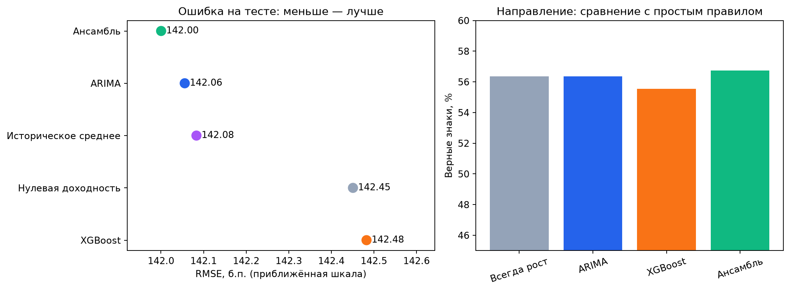

# Прогнозирование доходности AAPL: ARIMA, XGBoost и ансамбль

Исследование оформлено как **один последовательный Jupyter Notebook**: от происхождения и проверки данных до анализа ряда, построения признаков, обучения моделей и проверки результата. Все таблицы и графики в `reports/` создаются ячейками ноутбука. Готовые результаты при запуске не подгружаются.

**Открыть исследование:** [01_research_report.ipynb](notebooks/01_research_report.ipynb) · [HTML-версия](reports/research_report.html)



## Данные и метод

Источник — [исторические котировки Apple в Yahoo Finance](https://finance.yahoo.com/quote/AAPL/history/), полученные через [yfinance](https://ranaroussi.github.io/yfinance/reference/api/yfinance.download.html): дневные OHLCV за 2014–2024 годы, `auto_adjust=True`. Зафиксированный CSV находится в `data/aapl_2014_2024.csv` (2 768 строк). В начале ноутбука приведена функция повторной загрузки; по умолчанию она не вызывается.

Цель — прогноз логарифмической доходности следующего торгового дня. Все рыночные признаки используют только прошлые значения. Временное разбиение: **2014–2022 обучение**, **2023 валидация**, **2024 финальный тест**. ARIMA оценивается последовательными однодневными прогнозами, XGBoost подбирается временной кросс-валидацией, вес ансамбля определяется только на валидации.

## Результат на 252 днях 2024 года

| Прогноз | RMSE, б.п. ↓ | MAE, б.п. ↓ | Верное направление |
|---|---:|---:|---:|
| **Ансамбль** | **142,00** | **103,40** | **56,7%** |
| ARIMA | 142,06 | 103,43 | 56,3% |
| Историческое среднее | 142,08 | 103,44 | 56,3% |
| Нулевая доходность | 142,45 | 104,27 | — |
| XGBoost | 142,48 | 103,56 | 55,6% |

Ансамбль дал наименьшую RMSE, но выигрыш относительно ARIMA составляет лишь **0,06 б.п.** Интервал 95% по парному блочному bootstrap включает ноль; убедительных доказательств устойчивого преимущества на одном активе нет. Точность направления тоже следует оценивать относительно простого правила **«всегда рост» — 56,3%** на том же тесте.

Валидация выбрала ARIMA(0,0,0) и signed stacking с весами **1,666 для ARIMA** и **−0,666 для XGBoost**. Отрицательный вес здесь означает корректирующую компоненту XGBoost, а не ошибку в расчёте. В ноутбуке показана кривая ошибки по весам и объяснено ограничение результата.

## Структура

```text
data/aapl_2014_2024.csv        зафиксированные исходные данные
notebooks/01_research_report.ipynb
                                весь исследовательский код и выводы
reports/research_report.html    готовая версия для просмотра
reports/figures/               графики
reports/*.csv, *.json           прогнозы, метрики, настройки и диагностика
requirements.txt                версии библиотек
```

## Воспроизведение

Из корня проекта:

```bash
python3 -m venv .venv
source .venv/bin/activate
pip install -r requirements.txt

# macOS: системная библиотека для XGBoost
brew install libomp

jupyter lab notebooks/01_research_report.ipynb
```

В Jupyter выберите Python из созданного `.venv` и выполните **Run All**. Интернет для повторения зафиксированного эксперимента не требуется. Созданные ячейками таблицы и графики обновятся в `reports/`.
